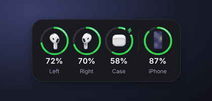
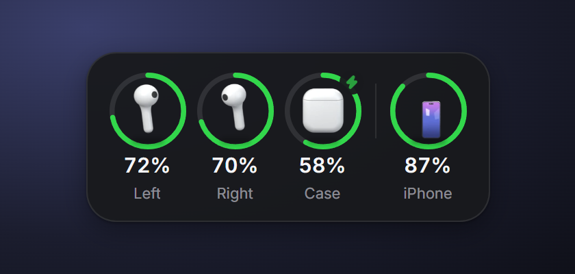
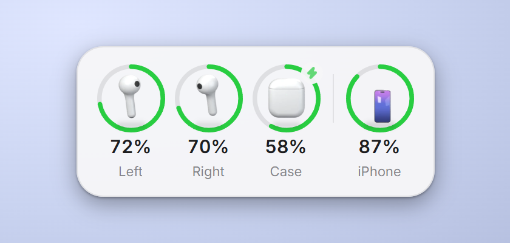
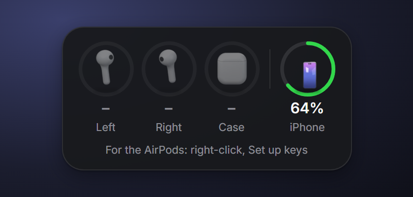

<p align="center">
  
</p>

<h1 align="center">AirPods Battery Widget for Windows</h1>

<p align="center">
  See the <b>exact</b> battery level of your AirPods (left, right, case) and your iPhone
  on Windows 10 and 11. A small always-on-top desktop widget, like the battery widget on iOS.
</p>

<p align="center">
  <a href="../../releases/latest"><b>Download the installer</b></a>
</p>

---

## Why

Windows does not know the battery level of AirPods at all. Tools like
AirPodsDesktop read it from the Bluetooth advert the AirPods broadcast, but
**current AirPods firmware no longer puts the level there in plain text**. You get
0 % or 10 % steps. The real values are still in the advert, encrypted with a key
that only your Apple devices know.

This widget decrypts them with that key, so you see the exact percentage for
each pod and the case. Everything else comes for free: any Bluetooth device whose
battery Windows already knows (your iPhone, a keyboard, a mouse) shows up next to it.

| Dark | Light |
| --- | --- |
|  |  |

- Exact levels for left, right and case, with a charging indicator
- iPhone and every other Bluetooth device Windows reports a battery for
- Rendered 3D models that turn once every 30 s, a ring per device, red at 20 % and below
- Drag it anywhere; it remembers where you put it
- Follows the Windows light or dark theme
- Starts with Windows, sits in the tray, no window in the taskbar
- No network access. Your keys never leave the PC.

## Install

1. Download `Battery-Widget_x.y.z_x64-setup.exe` from the
   [latest release](../../releases/latest) and run it. It installs for your user
   only and needs no admin rights.
2. Windows SmartScreen will warn you because the installer is not code-signed.
   Click **More info → Run anyway**.
3. The widget appears and starts with Windows from now on. The iPhone shows up
   right away if it is paired with the PC via Bluetooth (e.g. through Phone Link).

**Right-click the widget** (or the tray icon) for the menu:

| Menu item | What it does |
| --- | --- |
| Set up AirPods keys… | Opens `config.json` in your editor, creates it if needed |
| Restart | Reloads the config after you edited it |
| Start with Windows | Turns autostart on or off |
| Quit | Closes the widget |

## Set up your AirPods keys

The AirPods levels need two keys from your Apple account: `MagicAccIRK` and
`MagicAccEncKey`. You need a **Mac signed in to the same Apple ID** as the iPhone
your AirPods are paired with, once. After that the Mac is not needed anymore.



### 1. Find the Bluetooth address of your AirPods

On the Mac: **Apple menu → About This Mac → More Info → System Report →
Bluetooth**. Under your AirPods, note the **Address**, e.g. `AA:BB:CC:12:34:56`.

### 2. Read the keys from the keychain

1. Open **Keychain Access** (press <kbd>Cmd</kbd> + <kbd>Space</kbd>, type
   *Keychain Access*). On newer macOS versions, Spotlight offers the *Passwords*
   app instead; that is not the one. Keychain Access lives in
   *Applications → Utilities*.
2. Select the **iCloud** keychain on the left and **All Items** at the top.
3. Search for the address from step 1.
4. Open the entry whose **Account** reads `Public <your address>`.
   If there is no such entry, pair the AirPods with the Mac once and search again.
5. Tick **Show password** and enter your Mac password.
6. Copy the whole password text. It contains several values. You need the two
   next to **`MagicAccIRK`** and **`MagicAccEncKey`**, 32 hex digits each.

> [!WARNING]
> The same text also contains `LinkKey` and `MagicAccKey`. Those belong to the
> pairing itself. Do not paste them anywhere and do not share them.

### 3. Paste them into the widget

Right-click the widget → **Set up AirPods keys…**. This opens:

```
%APPDATA%\com.nexron.batterywidget\config.json
```

Paste both values **exactly as the keychain shows them**. Spaces, dashes and
angle brackets are fine, and you do not need to change the byte order:

```json
{
  "magicAccIrk": "<0a1b2c3d 4e5f6071 8293a4b5 c6d7e8f9>",
  "magicAccEncKey": "00112233445566778899aabbccddeeff",
  "hiddenDevices": []
}
```

Save the file, then right-click the widget → **Restart**.
Put your AirPods in or open the case, and the levels show up within seconds.

If the widget says *config.json is invalid*, a key does not have exactly 32 hex
digits. The log tells you which one (see [Troubleshooting](#troubleshooting)).

### Hide a device

Add the name exactly as the widget shows it to `hiddenDevices`, e.g.
`"hiddenDevices": ["MX KEYS S"]`, and restart.

## Good to know

- **The case shows "–"** while you wear both pods. AirPods only report the case
  level while at least one pod is inside it. Put one pod in once and the widget
  keeps the last value.
- **AirPods only broadcast while in use or while the case is open.** In the closed
  case nothing arrives; after 10 minutes without news the values are dimmed.
- **The iPhone level updates while the iPhone is connected via Bluetooth.**
  Windows keeps the last value otherwise.
- Tested with **AirPods 4 (ANC)**. Other models use the same advert format
  according to LibrePods, but they are untested. Reports are welcome.

## Troubleshooting

| Problem | Fix |
| --- | --- |
| *Bluetooth is off* | Turn Bluetooth on. The widget restarts its scan within a minute. |
| AirPods stay at "–" | Open the case next to the PC. Check that `magicAccEncKey` is right. |
| Values of someone else's AirPods | Cannot happen: adverts are matched against your `magicAccIrk`. |
| Anything else | Logs are in `%LOCALAPPDATA%\com.nexron.batterywidget\logs\`. |

## How it works

| Part | Where |
| --- | --- |
| BLE scan for Apple proximity-pairing adverts (WinRT `BluetoothLEAdvertisementWatcher`) | `src-tauri/src/ble_scanner.rs` |
| Decrypt the last 16 bytes with AES-128 and `MagicAccEncKey`, match the random address with `MagicAccIRK` | `src-tauri/src/airpods.rs` |
| Battery levels Windows knows: PnP property `{104EA319-6EE2-4701-BD47-8DDBF425BBE5} 2` on `BTHLE\DEV_*` | `src-tauri/src/device_battery.rs` |
| Widget UI | `src/` (Vue 3, Tailwind 4) |
| 3D models: built from primitives and rendered as a full turn in Blender | `tools/render-models/` |

Built with [Tauri 2](https://tauri.app), Rust and Vue 3.

## Development

Requirements: Node 22+, Rust (stable, MSVC), WebView2 (ships with Windows 11).

```sh
npm install
npm run tauri dev     # dev server on port 1440
npm test              # frontend tests (Vitest)
cd src-tauri && cargo test
npm run tauri build   # installer in src-tauri/target/release/bundle/nsis
```

The device models are rendered with Blender 5 (Cycles). To change one, edit
`tools/render-models/render_models.py`, then:

```sh
cd tools/render-models
blender --background --factory-startup --python render_models.py -- --model iphone --out <dir>/iphone
python build_sprites.py <dir> ../../src/assets/devices   # needs all four models rendered
```

## Credits

- [LibrePods](https://github.com/librepods-org/librepods) worked out the
  encrypted battery layout this widget decodes.
- The device models are our own, modelled in code in `tools/render-models/`.

AirPods and iPhone are trademarks of Apple Inc. This project is not affiliated
with Apple.

## License

[GPL-3.0](LICENSE)
